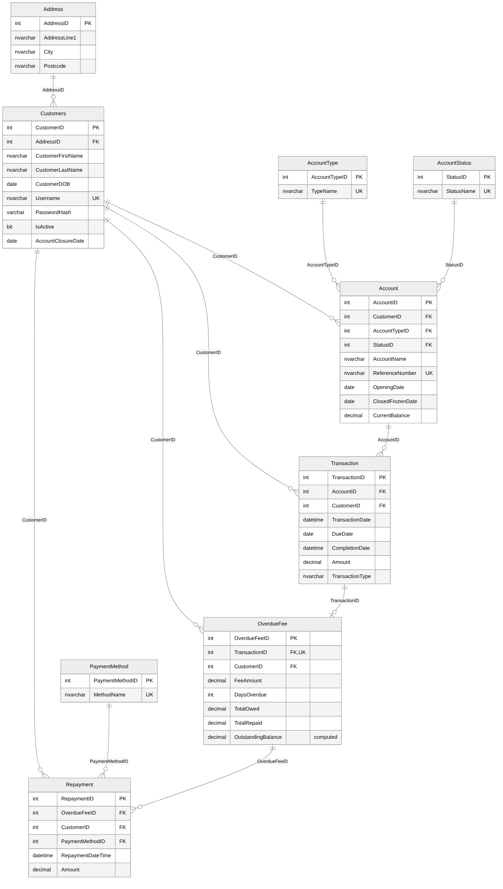

# Online Banking Database: Design and Business Logic in T-SQL

A relational database for an online bank, built in Microsoft SQL Server. It stores customers, their accounts and products, transactions, overdue fees and repayments, and uses stored procedures, views, triggers and a user-defined function to run the bank's day-to-day rules inside the database itself. Everything is in one script, [online_banking_database.sql](online_banking_database.sql).

---

## Scenario

An online bank is replacing its existing records with a new database. It needs to hold:

- **Customers**, with full name, address, date of birth, username and password, plus an optional email and phone number.
- **Accounts and products** of five types (Savings, Checking, Loan, Credit Card, Investment), each with an opening date and a status (Active, Dormant, Closed, Frozen). Loans carry a unique reference number.
- **Transactions** linking a customer to an account, with a due date for loan and credit card payments and a completion date that stays empty while the payment is pending.
- **Overdue fees** charged on late payments, with the total owed, the amount repaid and the outstanding balance.
- **Repayments** against those fees, each with a date, amount and payment method (bank transfer, card or cash).

When a customer leaves, their record must be kept for marketing and the closure date recorded. The bank processes hundreds of transactions a day, so balances must always be correct, while a few hours of downtime is acceptable.

## The business problem

The bank needed answers and actions it could rely on every day:

- **Finding an account quickly.** Staff need to search accounts by name, with the newest first.
- **Chasing payments before they are late.** Collections staff need to see every loan and credit card payment due in the next five days.
- **Adding and updating customers safely.** A new customer and their address must be saved together, or not at all.
- **Seeing the full picture of a transaction.** Compliance staff need every transaction alongside any fee it caused and every repayment made against that fee.
- **Keeping balances right automatically.** Balances should update when a payment completes, and a loan should close itself once it is fully paid, without anyone remembering to do it.
- **Spotting customers who are not repaying.** The collections team needs to see everyone who has repaid less than half of their overdue fees.

## Contents of the script

1. Database creation
2. Lookup tables (account type, account status, payment method)
3. Main tables (address, customers, accounts, transactions, overdue fees, repayments)
4. Indexes
5. Sample data (all fictional)
6. Stored procedures, each run with example inputs
7. View of all transactions with their fees and repayments
8. Triggers, with a before and after test
9. View and function for customers below 50% repayment
10. Additional objects: customer summary view, repayment trigger and a payment channel query
11. Security roles

## Normalisation

| Form | How the design meets it |
|---|---|
| **1NF** | Every column holds a single value and every table has its own key. Address is split from Customers so there are no repeated address fields. |
| **2NF** | Every table uses a single-column key, so no column can depend on only part of a key. |
| **3NF** | No column depends on another non-key column. Account types, statuses and payment methods live in lookup tables instead of repeated text, and the outstanding balance on a fee is a computed column, so it can never disagree with the amounts owed and repaid. |

## How the database solves it

### A design that protects the data

Nine tables are linked by foreign keys, and check constraints refuse impossible data. Examples include a date of birth in the future, a malformed email, a zero or negative transaction, a fee with no days overdue, an account closed before it opened, and a repayment that would take a fee above what is owed. Each transaction can carry at most one overdue fee, which is enforced by a unique key.

Customers are never deleted. Closing a customer sets them as inactive and records the closure date, so their history stays available for marketing as the bank requires.

Money is stored as exact decimals rather than floating-point numbers, so balances never pick up rounding errors.

### Stored procedures for everyday tasks

- **Account search** finds accounts by any part of their name and lists the most recently opened first.
- **Payments due soon** lists every pending loan and credit card payment due in the next five days, with the number of days left. The sample due dates are set relative to the day the script runs, so this always has results to show.
- **New customer** saves the address and the customer in one transaction. If anything fails, for example a username that is already taken, both are rolled back, so no orphaned address is left behind.
- **Update customer** changes contact details and active status. Marking a customer inactive records the closure date, and an unknown customer ID raises an error instead of silently doing nothing.

### One view of every transaction

A view joins each transaction to its customer, account and account type, then to any overdue fee and any repayments made against it. Left joins keep transactions that have no fee, so the view shows the complete history in one place.

### Triggers that run the bank's rules

- **Balances update on completion.** When a transaction is completed, either as it is inserted or when a pending one is later marked as complete, the account balance is adjusted. Deposits add to it, payments on loans and credit cards reduce the debt, and withdrawals, transfers and fees take money out. Changes are grouped per account, so a batch of transactions is applied in one update. Row-level locks stop two sessions from changing the same balance at the same time.
- **Paid-off loans close themselves.** Loan and credit card balances are held as negative amounts owed. When a completed payment moves a balance from owing to zero, the account is set to Closed and the date is recorded. Part payments reduce the debt without closing the account.
- **Repayments roll up automatically.** Each new repayment is added to its fee's total repaid. An overpayment breaks a check constraint, so it is refused and nothing is saved.

The script tests these triggers step by step. A part payment on one loan leaves it open. A final payment recorded as pending changes nothing. Marking it as complete clears the debt and closes the account.

### Customers who are falling behind

A view totals each customer's overdue fees and repayments and keeps only those who have repaid less than 50%. A scalar function returns how many customers that is, so the figure can be dropped into a report or dashboard. In the sample data, two customers fall below the line: one has repaid 36% and the other 33%.

### Extra insight

- A customer summary view shows each customer's number of accounts, net balance and number of transactions. The transaction count uses a correlated subquery so it does not distort the other totals.
- A payment channel query shows how overdue fees are repaid (bank transfer, card or cash) as counts, totals and percentages, to help plan collections.

### Security, integrity and recovery

- **Security.** Three roles (customer service, collections and reporting) are each granted only the procedures and views their job needs, with no direct access to the tables. Only password hashes are stored, and all inputs go through parameterised procedures, which protects against SQL injection. Transparent Data Encryption is recommended for the data files and backups.
- **Integrity and concurrency.** Multi-step changes run inside transactions with automatic rollback on error. Balance updates use row-level locks under the default read committed isolation, which prevents lost updates without slowing down other accounts.
- **Backup and recovery.** Because a few hours of downtime is acceptable but balances are critical, the recommended plan is the full recovery model, with nightly full backups, differential backups every four hours and transaction log backups every 15 minutes. That limits data loss to 15 minutes. Backups should be kept in two locations, with a monthly test restore.

## The outcome

The bank's key rules now live inside the database: balances stay correct, paid-off loans close themselves, overpayments are refused, and staff get the answers they need from a single procedure or view.

## Database objects at a glance

| Type | Objects |
|---|---|
| Tables | AccountType, AccountStatus, PaymentMethod, Address, Customers, Account, Transaction, OverdueFee, Repayment |
| Stored procedures | Search accounts by name, payments due soon, insert new customer, update customer |
| Views | All transactions with fees and repayments, customers below 50% repayment, customer account summary |
| Function | Count of customers below 50% repayment |
| Triggers | Update balance on completion, close paid-off loans and credit cards, roll up repayments |
| Roles | Customer service, collections, reporting |

## How to run

Open the file in SQL Server Management Studio and run the whole script. It recreates the database from scratch, loads the sample data, runs every procedure, view, function and trigger test, and shows the results.
